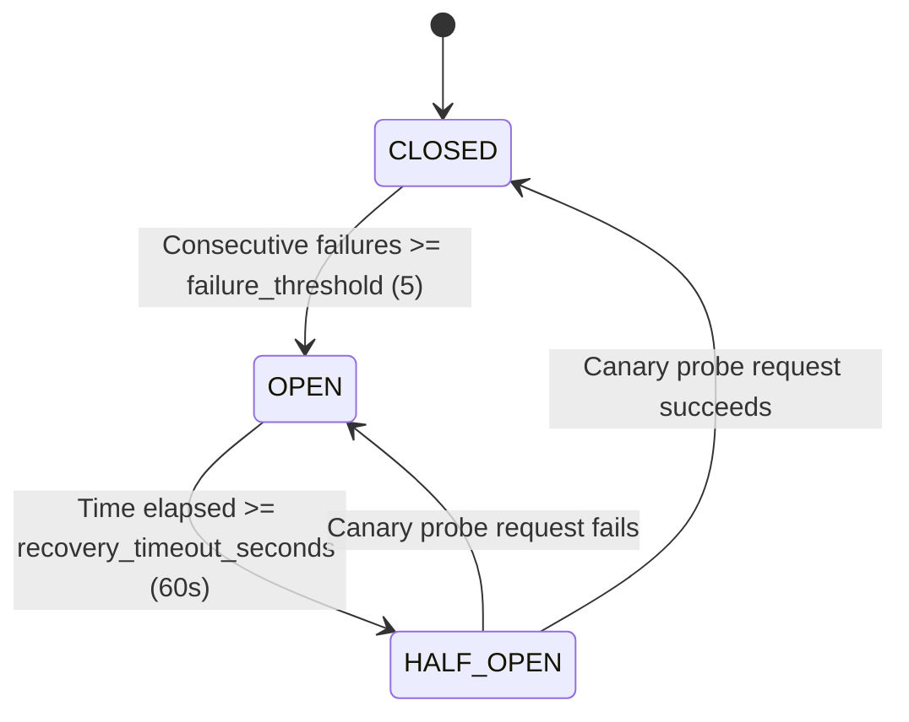

# AXLY Gateway: Distributed Circuit Breakers

## 1. Overview & Distributed State Machine

AXLY Gateway employs database-backed distributed circuit breakers to isolate failing providers or broken quota scopes, preventing cascading delays across concurrent client requests.

Unlike process-local in-memory circuit breakers, AXLY's circuit breakers are backed by PostgreSQL, ensuring identical state across any number of Uvicorn workers or multi-instance container replicas.



### State Definitions

| State | Behavior |
|---|---|
| `CLOSED` | Provider is healthy. All requests pass through normally. |
| `OPEN` | Provider is tripped. Candidate is excluded immediately without network I/O. |
| `HALF_OPEN` | Recovery timeout elapsed. Exactly one canary probe request is permitted through. |

---

## 2. Concurrency Safety & Database Locking

To prevent race conditions during high concurrent traffic spikes:

1. **Atomic Upsert:** Records are initialized using PostgreSQL's `INSERT ... ON CONFLICT (scope_type, scope_id) DO NOTHING`. Multiple concurrent threads attempting to initialize the breaker for a provider cannot collide or produce duplicate keys.
2. **Pessimistic Row-Level Locking (`SELECT FOR UPDATE`):** When recording a success or failure, or when claiming a probe in `HALF_OPEN` state, the circuit breaker row is locked with `with_for_update()`.
3. **Limited Canary Probes:** Only the configured number of probes (default: 1) are allowed in `HALF_OPEN`. Concurrent requests arriving while a probe is in-flight will see the breaker as temporarily occupied and route to other candidates.

---

## 3. Configuration & Transition Parameters

| Parameter | Default | Description |
|---|---|---|
| `failure_threshold` | 5 | Consecutive failures required to trip breaker from `CLOSED` to `OPEN`. |
| `recovery_timeout_seconds` | 60 | Elapsed seconds before breaker transitions from `OPEN` to `HALF_OPEN`. |
| `half_open_probes_allowed` | 1 | Number of test requests allowed to verify upstream recovery. |

### Transition History
Every state transition is timestamped and recorded in the JSON `history` column:
```json
[
  {
    "from": "CLOSED",
    "to": "OPEN",
    "reason": "Threshold reached: 5 consecutive failures",
    "timestamp": "2026-11-21T18:40:12.102Z"
  },
  {
    "from": "OPEN",
    "to": "HALF_OPEN",
    "reason": "Recovery timeout elapsed (60s)",
    "timestamp": "2026-11-21T18:41:12.105Z"
  },
  {
    "from": "HALF_OPEN",
    "to": "CLOSED",
    "reason": "Probe request succeeded",
    "timestamp": "2026-11-21T18:41:13.450Z"
  }
]
```

---

## 4. Administrative Observation & Reset APIs

- **List All Circuit Breakers:**
  ```http
  GET /api/admin/circuit-breakers
  ```
  Returns current state, failure counters, thresholds, and transition timestamps.
- **Manual Reset Breaker:**
  ```http
  POST /api/admin/circuit-breakers/{id}/reset
  ```
  Forces the breaker immediately back to `CLOSED`, clears failure counts, and records an admin override in history.
