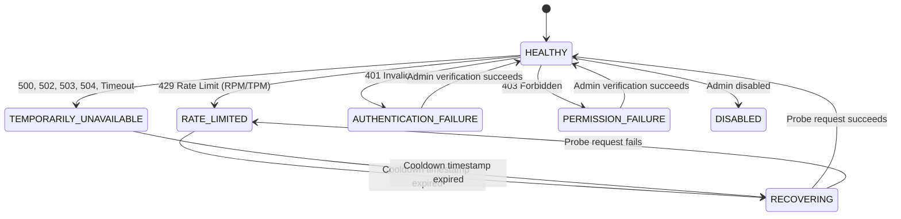

# AXLY Gateway: Cooldown Policies & Automatic Recovery

## 1. Cooldown Principles & Health States

AXLY Gateway enforces precise cooldown policies to protect degraded upstream providers and prevent repetitive, costly failure cycles. Every credential and quota group is governed by explicit state tracking:



### Health State Definitions

| State | Retriable? | Description |
|---|---|---|
| `healthy` | Yes | Fully operational, available for priority routing. |
| `rate_limited` | Cooldown | In temporary cooldown due to RPM/TPM spike. Auto-recovers on expiry. |
| `temporarily_unavailable` | Cooldown | In temporary cooldown due to upstream 503/timeout. Auto-recovers on expiry. |
| `authentication_failure` | No | API key revoked, rejected, or invalid. **Permanent lockout until verified.** |
| `permission_failure` | No | Account lacks scope or model access. Locked until manual admin update. |
| `disabled` | No | Administratively disabled (`is_active = False`). |
| `recovering` | Canary | Cooldown expired; eligible for a controlled probe request. |

---

## 2. Cooldown Duration & Backoff Formulas

Cooldown durations are calculated based on error severity and consecutive failure counts:

### Base Durations
- `rate_limit`: 30.0 seconds
- `quota_exhausted`: 60.0 seconds
- `service_unavailable`: 45.0 seconds
- `timeout`: 20.0 seconds
- `network_error`: 15.0 seconds

### Exponential Backoff & Jitter Formula

$$\text{backoff} = \min(\text{base} \times 2^{\text{consecutive\_failures}}, \text{MAX\_COOLDOWN})$$

$$\text{jitter} = \text{uniform}(0.85, 1.15)$$

$$\text{cooldown\_seconds} = \max(\text{Retry-After}, \text{backoff} \times \text{jitter})$$

Where `MAX_COOLDOWN = 1800.0` seconds (30 minutes).

### Header Priority (`Retry-After`)
If the upstream provider sends a standard HTTP `Retry-After` header (integer seconds or delta), the engine prioritizes that explicit upstream instruction over internal heuristics.

---

## 3. Automatic Recovery Lifecycle

1. **Timestamp Persistence:** Cooldown deadlines are stored as `cooldown_until` in PostgreSQL. No in-memory state or background polling workers are required.
2. **On-Demand Expiry Check:** When `CredentialSelector` examines candidates, `CooldownManager.check_and_recover_credential` evaluates:
   ```python
   if health.cooldown_until and utc_now() >= health.cooldown_until:
       health.status = "recovering"
   ```
3. **Probe Execution:** The recovering credential is permitted to handle a controlled request.
4. **Transition to Healthy:** Upon a successful response, `HealthTracker.record_success` resets `consecutive_failures = 0`, sets `status = "healthy"`, and clears `cooldown_until`.

---

## 4. Safety Guard Against Unverified Authentication Recovery

> [!CAUTION]
> Prompt 3 Section 8 strictly mandates that a credential marked with `authentication_failure` must NEVER be automatically unblocked or blindly recovered without verification.

If an administrator invokes `POST /api/admin/credentials/{id}/recover`:
1. If `validate_upstream: true` (default), the gateway performs a live canary ping (`GET /v1/models` or lightweight completion) using that decrypted key against the actual upstream provider.
2. If upstream rejects the key with 401/403, the recovery request is aborted with HTTP 400 Bad Request:
   ```json
   {
     "error": {
       "message": "Credential recovery rejected: upstream validation failed: Incorrect API key provided",
       "type": "validation_error"
     }
   }
   ```
3. The credential remains strictly locked in `authentication_failure`, protecting the gateway against invalid key cycling.
