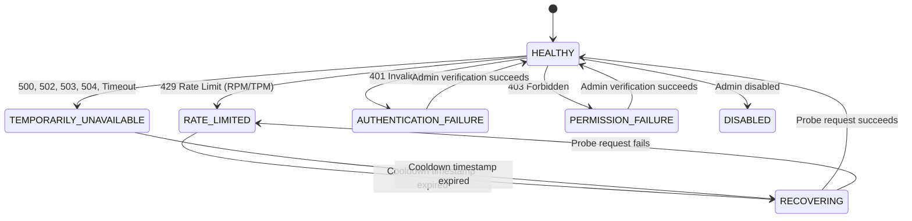

# AXLY Gateway: Cooldown Policies & Automatic Recovery

## 1. Cooldown Principles & Health States

AXLY Gateway enforces precise cooldown policies to protect degraded upstream providers and prevent repetitive, costly failure cycles. Every credential and quota group is governed by explicit state tracking:



### Health State Definitions

| State | Retriable? | Description |
|---|---|---|
| `healthy` | Yes | Fully operational, available for priority routing. |
| `rate_limited` | Cooldown | In temporary cooldown due to RPM/TPM spike. Auto-recovers on expiry. |
| `temporarily_unavailable` | Cooldown | In temporary cooldown due to upstream 503/timeout. Auto-recovers on expiry. |
| `authentication_failure` | No | API key revoked, rejected, or invalid. **Permanent lockout until verified.** |
| `permission_failure` | No | Account lacks scope or model access. Locked until manual admin update. |
| `disabled` | No | Administratively disabled (`is_active = False`). |
| `recovering` | Canary | Cooldown expired; eligible for a controlled probe request. |

---

## 2. Cooldown Duration & Backoff Formulas

Cooldown durations are calculated based on error severity and consecutive failure counts:

### Default Base and Maximum Durations

| Error category | Base | Backoff factor | Maximum |
|---|---:|---:|---:|
| `rate_limit` | 30 seconds | 2.0 | 900 seconds |
| `quota_exhausted` | 120 seconds | 2.0 | 3,600 seconds |
| `service_unavailable` | 15 seconds | 2.0 | 300 seconds |
| `timeout` | 10 seconds | 1.5 | 120 seconds |
| `network_error` | 10 seconds | 1.5 | 120 seconds |
| `unknown` | 20 seconds | 1.5 | 300 seconds |

### Exponential Backoff & Jitter Formula

For a transient failure without an upstream retry instruction:

$\text{backoff} = \min(\text{base} \times \text{factor}^{\text{consecutive\_cooldowns}}, \text{category maximum})$

$\text{cooldown} = \text{uniform}(\text{backoff} \times (1-j), \text{backoff} \times (1+j))$

The default jitter ratio `j` is 0.20 (±20%). The cooldown streak is persisted per credential in `consecutive_cooldowns`; the first cooldown uses exponent 0. A successful request resets the streak.

### Configuration Overrides

Set these optional environment variables to override a category's policy. `<CATEGORY>` is the uppercase enum name, for example `RATE_LIMIT`, `SERVICE_UNAVAILABLE`, or `NETWORK_ERROR`.

- `AXLY_COOLDOWN_<CATEGORY>_BASE_SECONDS`
- `AXLY_COOLDOWN_<CATEGORY>_MAX_SECONDS`
- `AXLY_COOLDOWN_<CATEGORY>_BACKOFF_FACTOR`
- `AXLY_COOLDOWN_JITTER_RATIO` (0.0 to 1.0)

Values are validated and bounded by the policy reader; invalid numeric values fall back to defaults.

### Header Priority (`Retry-After`)

When the upstream sends `Retry-After`, its value is authoritative: delta-seconds and HTTP-date formats are parsed, and the persisted cooldown is set to at least that exact delay without adding jitter or truncating it. The short in-request delay before trying another candidate remains separately bounded so the gateway can fail over to a different credential/provider instead of holding the client request for a long cooldown.

---

## 3. Automatic Recovery Lifecycle

1. **Timestamp Persistence:** Cooldown deadlines are stored as `cooldown_until` in PostgreSQL. No in-memory state or background polling workers are required.
2. **On-Demand Expiry Check:** When `CredentialSelector` examines candidates, `CooldownManager.check_and_recover_credential` evaluates:
   ```python
   if health.cooldown_until and utc_now() >= health.cooldown_until:
       health.status = "recovering"
   ```
3. **Probe Execution:** The recovering credential is permitted to handle a controlled request.
4. **Transition to Healthy:** Upon a successful response, `HealthTracker.record_success` resets `consecutive_failures = 0`, sets `status = "healthy"`, and clears `cooldown_until`.

---

## 4. Safety Guard Against Unverified Authentication Recovery

> [!CAUTION]
> Prompt 3 Section 8 strictly mandates that a credential marked with `authentication_failure` must NEVER be automatically unblocked or blindly recovered without verification.

If an administrator invokes `POST /api/admin/credentials/{id}/recover`:
1. If `validate_upstream: true` (default), the gateway performs a live canary ping (`GET /v1/models` or lightweight completion) using that decrypted key against the actual upstream provider.
2. If upstream rejects the key with 401/403, the recovery request is aborted with HTTP 400 Bad Request:
   ```json
   {
     "error": {
       "message": "Credential recovery rejected: upstream validation failed: Incorrect API key provided",
       "type": "validation_error"
     }
   }
   ```
3. The credential remains strictly locked in `authentication_failure`, protecting the gateway against invalid key cycling.
