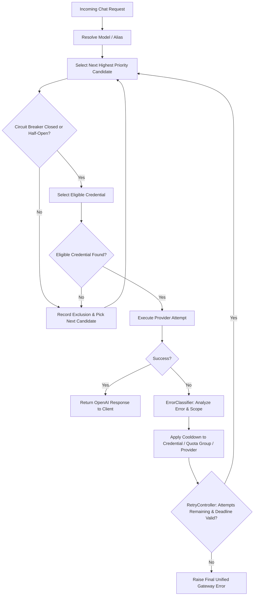
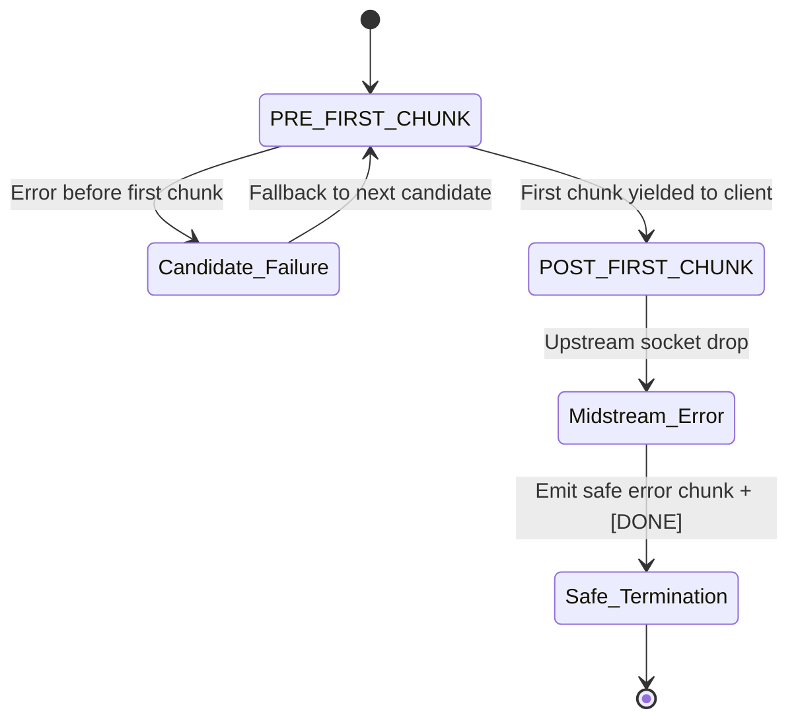

# AXLY Gateway: Automatic Failover Engine

## 1. Failover Principles & Architecture

AXLY Gateway implements an autonomous, bounded failover engine designed to maintain continuous LLM availability in the face of upstream outages, network blips, and rate limit exhaustion.



---

## 2. Cross-Provider Fallback Scenario

Consider a client sending a completion request using alias `fast`:
1. **Candidate 1 (Google Gemini - `gemini-1.5-flash`):**
   - Attempt 1 uses Gemini Key 01.
   - Upstream responds with HTTP 429 (`RESOURCE_EXHAUSTED` / Project Quota Exceeded).
   - The engine identifies this as a **project-scoped quota failure**.
   - Gemini Key 01 is placed in cooldown.
   - The associated `QuotaGroup` is placed in cooldown, which immediately excludes sibling Gemini Key 02 from redundant attempts.
2. **Candidate 2 (Groq Cloud - `llama-3.1-8b-instant`):**
   - The engine automatically shifts to Candidate 2 without client interaction.
   - Attempt 2 uses Groq Key 01.
   - Upstream responds with HTTP 503 (`Service Unavailable`).
   - Groq Key 01 and Groq's circuit breaker failure count are updated.
3. **Candidate 3 (OpenAI - `gpt-4o-mini`):**
   - The engine shifts to Candidate 3.
   - Attempt 3 uses OpenAI Key 01.
   - Upstream responds with HTTP 200 OK.
   - The response is returned to the client, reporting `model: "fast"`.
   - The entire 3-attempt lifecycle is recorded in `routing_history`.

---

## 3. Bounded Retry Controller & Request Deadlines

To prevent unbounded request storms and cascading latency, `RetryController` enforces:

1. **Maximum Attempts (`max_attempts`):**
   - Configurable per profile, per alias, or defaulting to gateway-wide policy (default: 3 attempts).
   - Hard maximum cap enforced to guarantee execution termination.
2. **Overall Request Deadline:**
   - Evaluated at every retry iteration. If the remaining wall-clock time budget expires, the engine aborts failover immediately and returns an upstream timeout error.
3. **Per-Attempt Timeout:**
   - Dedicated socket and HTTP request timeout applied to each individual upstream provider call.
4. **Client Disconnection Detection:**
   - In FastAPI, the engine polls `request.is_disconnected()` prior to attempting subsequent candidates to avoid orphan computation if the client disconnects.
5. **Exponential Backoff & Bounded Jitter:**
   - Retries apply decorrelated exponential jitter to prevent thundering herds across upstream endpoints.

---

## 4. Streaming Invariance & Failover Restrictions

Streaming requests (`stream: true`) present a critical architectural constraint: **once the first chunk is sent over Server-Sent Events (SSE), the HTTP connection and response stream are locked to that candidate.**



### Pre-First-Chunk Failover (Permitted)
If Candidate 1 crashes, times out, or returns a 429/503 before yielding any content bytes to the client:
- The engine safely discards the failed generator.
- Failover seamlessly shifts to Candidate 2.
- The client receives a clean, complete response stream starting with Candidate 2's initial chunk.

### Post-First-Chunk Failover (Strictly Prohibited)
If Candidate 1 crashes after one or more chunks have been transmitted to the client:
- The engine **NEVER** switches to another provider mid-stream. Switching providers mid-stream would result in duplicate prefix tokens, conflicting tokenizers, corrupted JSON/code streams, and client parser crashes.
- The engine immediately terminates the SSE connection by emitting a normalized OpenAI error chunk:
  ```json
  {"error": {"message": "Upstream stream interrupted mid-generation", "type": "stream_error", "code": "upstream_interrupted"}}
  ```
  followed by `data: [DONE]`.

---

## 5. Audit Logging & Routing History Traces

Every execution attempt is permanently recorded in `routing_history` for compliance, debugging, and cost attribution:

| Field | Description | Example |
|---|---|---|
| `request_id` | Unified correlation identifier | `req-84920481` |
| `requested_model_or_alias` | Raw model string from client | `fast` |
| `attempt_number` | 1-indexed attempt counter | `1` |
| `provider_name` | Upstream provider attempted | `gemini` |
| `model_identifier` | Concrete upstream model | `gemini-1.5-flash` |
| `credential_label` | Display label of credential | `Gemini Project Key 01` |
| `latency_ms` | Elapsed time for this attempt | `342.5` |
| `result` | Outcome | `failure` / `success` |
| `status_code` | HTTP status code received | `429` |
| `error_category` | Classified error type | `quota_exhausted` |
| `retry_decision` | Action taken by retry controller | `failover_candidate` |
| `cooldown_applied` | Whether cooldown was initiated | `true` |
| `cooldown_seconds` | Cooldown duration calculated | `60.0` |

Administrators can inspect traces via:
```http
GET /api/admin/routing/history?request_id=req-84920481
```
