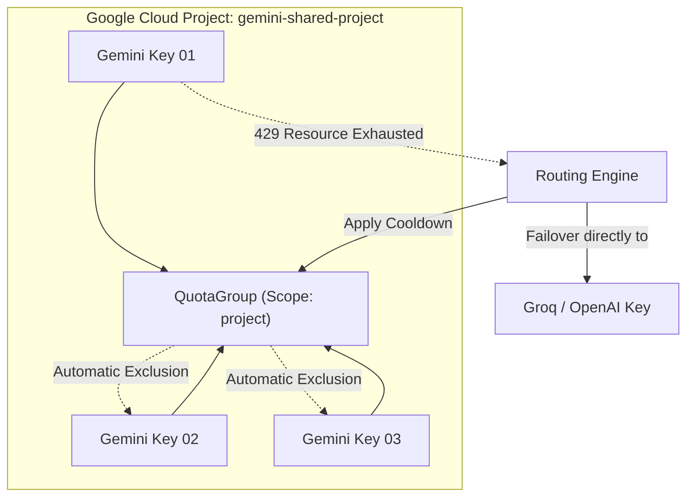

# AXLY Gateway: Quota Management & Shared Limit Groups

## 1. Overview & Problem Definition

In modern cloud AI architectures, multiple API credentials do not necessarily provide independent rate limits or quota boundaries:

- Multiple Google Gemini API keys may belong to the same Google Cloud Project or Firebase project, sharing a single requests-per-minute (RPM) and token-per-minute (TPM) quota.
- Multiple OpenAI keys may belong to the same Organization or Project ID, drawing from a shared tier budget or daily rate limit.
- Multiple Groq keys may be tied to the same billing account.

Naively cycling through sibling keys when a shared project quota is exhausted results in redundant failures, wasted latency, increased circuit breaker trips, and potential upstream account penalties.

AXLY Gateway solves this with **Quota Groups**.



---

## 2. Quota Scopes

`QuotaGroup` records define boundaries for limit enforcement across five distinct scopes:

| Scope Type | Description | Upstream Example |
|---|---|---|
| `credential` | Isolated key with independent limits | Free-tier standalone developer API keys |
| `project` | Shared project quota across multiple keys | Google Cloud Project ID quota |
| `organization` | Shared enterprise organization quota | OpenAI Organization ID rate limits |
| `provider` | Provider-wide global account ceiling | Monthly spend limits, credit exhaustion |
| `model_family` | Shared capacity across a model group | Quotas shared between `gpt-4o` and `gpt-4o-mini` |

---

## 3. Quota Classification Engine

When an upstream provider returns a 429 or 403 status code, `ErrorClassifier` extracts structured signals to determine whether the error represents a short-term request rate limit or a shared project/billing exhaustion:

```python
# Project Quota Indicators
"resource_exhausted", "insufficient_quota", "quota exceeded",
"project quota", "daily limit", "requests per day", "billing", "tier limit"
```

1. **Short-Term Rate Limit (`rate_limit`):**
   - Typically RPM or TPM spikes.
   - Applied at `credential` scope.
   - Sibling keys in the same project remain eligible if independent key buckets exist.
2. **Project / Account Quota Exhaustion (`quota_exhausted`):**
   - Typically daily requests exhaustion, billing quota cap, or project resource exhaustion.
   - Applied at `project` or `organization` scope across the entire `QuotaGroup`.
   - **Immediately excludes all sibling credentials belonging to that group.**
   - Fails over directly to an alternative provider candidate.

---

## 4. Quota Group Database Model

```sql
CREATE TABLE quota_groups (
    id UUID PRIMARY KEY,
    name VARCHAR(128) NOT NULL,
    provider_id UUID NOT NULL REFERENCES providers(id),
    scope_type VARCHAR(32) NOT NULL, -- credential, project, organization, provider, model_family
    status VARCHAR(32) NOT NULL DEFAULT 'healthy', -- healthy, rate_limited, quota_exhausted, in_cooldown
    cooldown_until TIMESTAMP WITH TIME ZONE,
    last_quota_error_at TIMESTAMP WITH TIME ZONE,
    last_error_category VARCHAR(64),
    last_error_details JSON,
    reset_info JSON,
    policy JSON,
    consecutive_failures INTEGER NOT NULL DEFAULT 0,
    created_at TIMESTAMP WITH TIME ZONE NOT NULL,
    updated_at TIMESTAMP WITH TIME ZONE NOT NULL
);
```

---

## 5. Automatic Recovery & Administrative Overrides

### Automatic Cooldown Expiry
- All cooldown deadlines are persisted as UTC timestamps in the database (`cooldown_until`).
- When a request evaluates a quota group whose `cooldown_until <= utc_now()`, `QuotaManager.is_quota_group_eligible` automatically clears the cooldown, resets `status = 'healthy'`, and restores candidate eligibility without requiring server restarts or polling daemons.

### Manual Administrative Overrides
Administrators can inspect, clear, or trigger cooldowns on quota groups via the Admin API:

- **List Quota Groups:**
  ```http
  GET /api/admin/quota-groups
  ```
- **Create Quota Group:**
  ```http
  POST /api/admin/quota-groups
  Content-Type: application/json

  {
    "name": "gemini-prod-project",
    "provider_id": "893ef86c-...",
    "scope_type": "project"
  }
  ```
- **Manual Reset / Recover:**
  ```http
  POST /api/admin/quota-groups/{quota_group_id}/reset
  ```
  Immediately clears `cooldown_until`, sets status to `healthy`, and logs an administrative audit trace.
