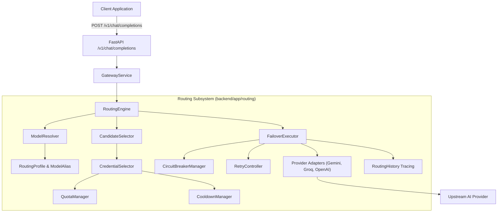

# AXLY Gateway: Intelligent Routing Engine

## 1. Overview & Architecture

AXLY Gateway delivers an enterprise-grade, resilient, multi-provider intelligent routing engine for LLM inference. Designed with strict separation of concerns, the engine orchestrates candidate resolution, multi-credential priority selection, quota-aware grouping, and fault-tolerant execution transparently behind an OpenAI-compatible interface:

```http
POST /v1/chat/completions
```

Clients interact exclusively with model aliases or catalog models without awareness of which upstream provider (OpenAI, Google Gemini, or Groq Cloud) handles the request.



---

## 2. Model Resolution & Aliases

The routing engine supports two entry modes:

1. **Configurable Model Aliases (`fast`, `smart`, `coding`, `cheap`):**
   - High-level, abstract routing identifiers configured by administrators.
   - Dynamic resolution against database-backed candidate lists ordered by priority.
   - Includes timeout constraints, capability requirements (e.g., `streaming`, `function_calling`), and maximum attempt overrides.
2. **Explicit Catalog Identifiers:**
   - Clients can specify exact catalog model identifiers (e.g., `gpt-4o-mini`, `gemini-1.5-pro`, `llama-3.1-70b-versatile`).
   - The engine validates enablement in `models_catalog` and routes to the provider adapter associated with that specific model.

### Pre-Configured Aliases

| Alias | Description | Default Top Candidates |
|---|---|---|
| `fast` | Ultra-low latency inference tier | 1. Groq (`llama-3.1-8b-instant`)<br>2. Gemini (`gemini-1.5-flash`)<br>3. OpenAI (`gpt-4o-mini`) |
| `smart` | High-reasoning and complex prompt tier | 1. OpenAI (`gpt-4o`)<br>2. Gemini (`gemini-1.5-pro`)<br>3. Groq (`llama-3.3-70b-versatile`) |
| `coding` | Code synthesis, refactoring, and review tier | 1. OpenAI (`gpt-4o`)<br>2. Gemini (`gemini-1.5-pro`)<br>3. Groq (`llama-3.3-70b-versatile`) |
| `cheap` | Cost-optimized batch and processing tier | 1. Gemini (`gemini-1.5-flash`)<br>2. Groq (`llama-3.1-8b-instant`)<br>3. OpenAI (`gpt-4o-mini`) |

---

## 3. Candidate & Credential Selection

### Candidate Selection Algorithm

1. **Filter by Capabilities:** Candidates lacking required features for the request (e.g., vision, streaming, JSON schema enforcement) are excluded.
2. **Filter by Circuit Breaker:** Any candidate provider currently in an `OPEN` circuit breaker state is excluded unless it has transitioned to `HALF_OPEN` for canary testing.
3. **Sort by Priority:** Candidates are sorted ascending by `priority` (1 = highest priority).
4. **Deduplication:** Repeated provider/model candidates within the same request cycle are deduplicated.

### Multi-Credential Priority Selection

Each provider supports multiple API keys (e.g., 3 Gemini keys, 2 Groq keys, 2 OpenAI keys). For each candidate provider:

1. Active credentials (`is_active = True`) are fetched from PostgreSQL ordered by `priority ASC, created_at ASC`.
2. Any credential already attempted during the current request is skipped.
3. The credential's associated **Quota Group** is checked. If the quota group is currently under active cooldown, the credential is automatically excluded.
4. The credential's **CredentialHealth** record is evaluated. If the credential is in active cooldown, marked as `authentication_failure`, or marked as `disabled`, it is excluded.
5. If eligible, the encrypted secret is securely decrypted in-memory using AES-256-GCM. Decrypted keys are never logged, persisted in audit history, or exposed over the API.

---

## 4. Administrative Configuration APIs

All routing profiles, aliases, and candidate assignments are database-backed and take effect immediately without requiring service restarts.

### 1. Routing Profiles CRUD

- `GET /api/admin/routing/profiles`: List all routing profiles.
- `POST /api/admin/routing/profiles`: Create a new profile.
  ```json
  {
    "name": "enterprise-priority",
    "description": "Standard high-availability profile",
    "strategy": "priority",
    "max_attempts": 4,
    "request_timeout_seconds": 30.0,
    "is_default": true
  }
  ```
- `GET /api/admin/routing/profiles/{profile_id}`: Retrieve profile details.
- `PATCH /api/admin/routing/profiles/{profile_id}`: Update profile configuration.
- `DELETE /api/admin/routing/profiles/{profile_id}`: Delete unused profile.

### 2. Model Aliases & Candidates CRUD

- `GET /api/admin/routing/aliases`: List configured aliases with candidate details.
- `POST /api/admin/routing/aliases`: Create an alias.
  ```json
  {
    "alias_name": "fast",
    "description": "Fast multi-provider routed alias",
    "is_enabled": true,
    "max_attempts": 3,
    "timeout_seconds": 25.0
  }
  ```
- `PUT /api/admin/routing/aliases/{alias_id}/candidates`: Replace alias candidate list.
  ```json
  {
    "candidates": [
      {
        "provider_id": "893ef86c-...",
        "model_id": "31b1c618-...",
        "priority": 1,
        "weight": 1.0,
        "is_enabled": true
      },
      {
        "provider_id": "42bf09de-...",
        "model_id": "76efca84-...",
        "priority": 2,
        "weight": 1.0,
        "is_enabled": true
      }
    ]
  }
  ```
- `DELETE /api/admin/routing/aliases/{alias_id}`: Remove an alias.
